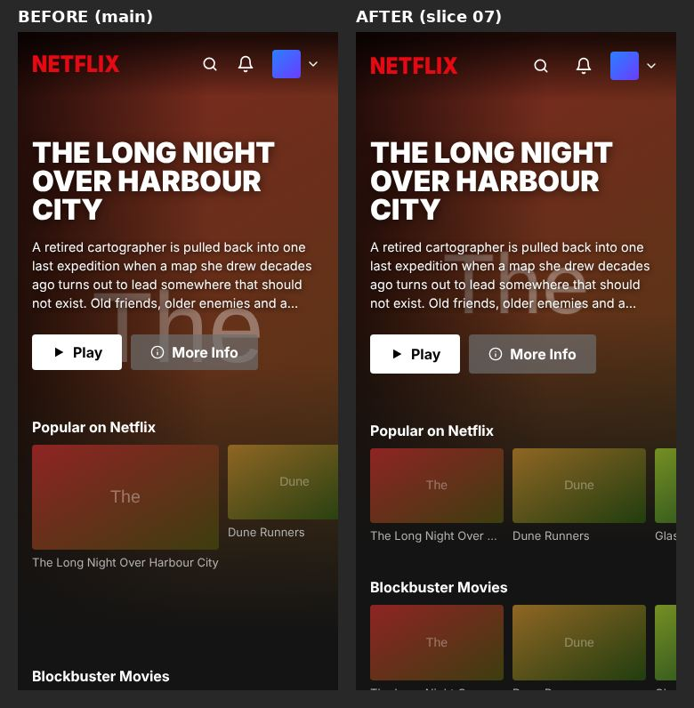
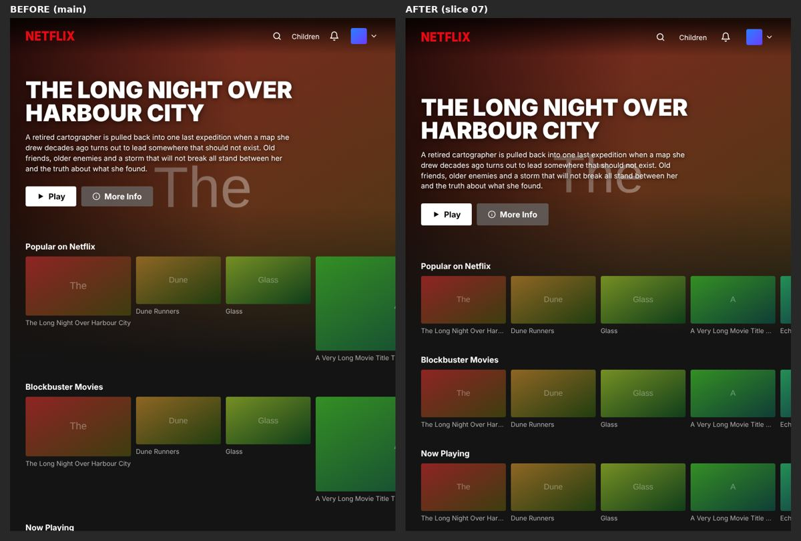
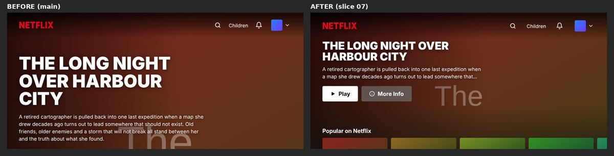
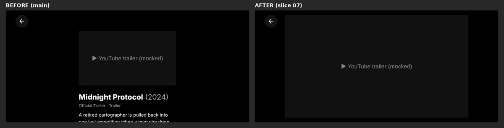

# 07 — Responsive pass

**Goal:** every page (home, login / sign-up, player, 404) works on a phone, a tablet and a
desktop, with touch and mouse, before the app is deployed in slice 08.

This is a final audit, not the first mobile pass: slices 01–06 were each checked at 360px when
they merged (PRD §5). The sweep below is what was measured, and the criteria are what this
slice fixes.

## How it was checked

A Playwright script loads each page with TMDB, Firebase Auth, TMDB images and the YouTube embed
mocked (the cloud sandbox reaches none of them), signs in through the real login form, and at
each viewport:

- screenshots the page;
- checks for horizontal page overflow (`scrollWidth > clientWidth`) and any element poking out
  of the viewport that is not inside a scroller;
- lists every link, button and input smaller than 44×44px (Apple HIG / WCAG 2.5.5 AAA; WCAG 2.2
  AA's hard floor is 24×24);
- taps the account menu to see whether it opens.

| Name            | Viewport | Input                   |
| --------------- | -------- | ----------------------- |
| phone-360       | 360×740  | touch (small Android)   |
| phone-390       | 390×844  | touch (current iPhone)  |
| phone-landscape | 844×390  | touch (iPhone, rotated) |
| tablet-768      | 768×1024 | touch (iPad portrait)   |
| laptop-1024     | 1024×768 | mouse                   |
| desktop-1440    | 1440×900 | mouse                   |

## What the sweep found

1. **Long titles stretch row cards (all widths).** A flex item's minimum width defaults to its
   content, and the card's caption is `nowrap`, so a long title like "The Lord of the Rings: The
   Return of the King" widens its card. With the 16:9 artwork that also makes it taller, so rows
   get ragged cards and big empty gaps below. Most visible on phones.
2. **Account menu is unreliable on touch.** It opens on `:hover` / `:focus-within`. Mobile
   Safari does not focus a button on tap, so on iPhone "Sign out" may never appear, and there is
   no way to close it by tapping the button again.
3. **Phone in landscape:** the hero title fills the whole 390px-tall screen and pushes Play below
   the fold; the player is capped to a 338px-wide video with empty space on both sides.
4. **Tap targets under 44px:** navbar Search / Notifications (28×28), profile button (62×40),
   hero Play / More Info (40 tall), player "Back to home" (36 tall), 404 link (40 tall),
   "Remember me" (17 tall).
5. **`100vh` on mobile browsers** is the height with the URL bar hidden, so full-height pages
   (login, player, 404) are taller than the visible screen and the 404 content sits low.

No page overflowed horizontally at any viewport, the title-row arrows were already hidden on
touch-only devices, and the login page already switches to Netflix's flat mobile layout below
600px. Those need no change.

## Acceptance criteria

**All breakpoints**

- [ ] No horizontal page scroll on any page at 360, 390, 768, 1024 or 1440px wide, or 844×390.
- [ ] Every card in a row is the same size whatever the title length; long names truncate with
      an ellipsis.
- [ ] The account menu opens and closes by click / tap on its button (`aria-expanded` reflects
      it), closes on Escape, on a tap or click outside, and when focus leaves it. Mouse hover
      still opens it on desktop.
- [ ] Full-height pages use the dynamic viewport height (`100dvh`, with `100vh` as fallback).

**Phone (≤ 600px) and tablet (touch)**

- [ ] On touch screens (`pointer: coarse`) navbar icons, the profile button, hero buttons,
      player buttons and the 404 link are at least 44×44px, and "Remember me" has a 44px-tall
      tap area, without changing the visible layout on desktop.
- [ ] Row arrows stay hidden on touch-only devices (swipe instead); rows still snap per card.

**Short landscape screens (height ≤ 500px)**

- [ ] The hero's Play button is visible without scrolling at 844×390.
- [ ] The player video uses the available height (fills ~the screen height, still 16:9) and does
      not sit under the back button.

**Desktop (≥ 1024px, mouse)**

- [ ] No visual change from `main` apart from the card-width fix and the menu also opening on
      click.

- [ ] `npm run lint`, `format:check`, `type-check` and `build` pass in CI.

## Out of scope for this slice

- **Hamburger menu.** Slice 01 left this as slice 07's call. Decision: no hamburger. Below 900px
  the text links hide, and the only link that goes anywhere ("Home") is the same as the logo.
  A menu full of links that do nothing would be worse on a phone than no menu. Revisit if
  real pages (My List, search) are ever added.
- Visual redesign, new breakpoints for very large (4K) screens, or a print stylesheet.
- Sticky `:hover` styles after a tap on touch screens (cosmetic, and the tap navigates away).
- Automated visual-regression tests (still no test runner). The audit script is described here
  but not committed, matching how slices 04–06 were verified.

## Notes / decisions

- **Tutorial comparison.** The tutorial's responsive step adds `max-width` media queries that
  shrink fonts and hide the navbar links and hero caption on small screens. Most of that was
  done per slice already with `clamp()`; this slice fixes behaviour (touch, landscape, card
  sizing) rather than adding more breakpoints.
- **44px only on coarse pointers.** Enlarging the hit area with `@media (pointer: coarse)` keeps
  the desktop look identical while meeting the touch guideline where it matters. Where a bigger
  box would shift the layout, the extra space is added as padding with a matching negative
  margin.

## Screenshots (mocked data, before → after)

